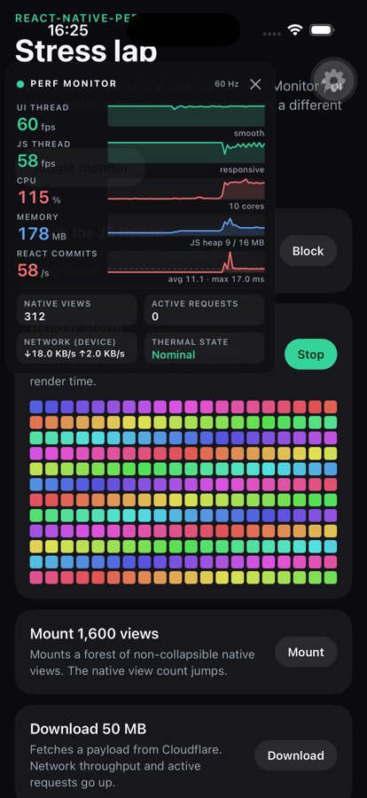
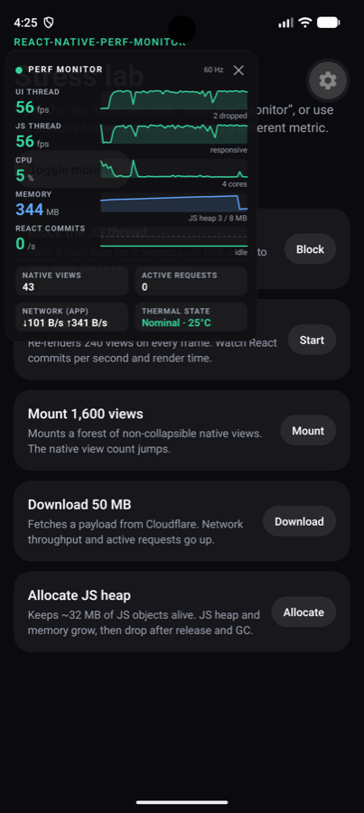

<div align="center">

# react-native-perf-monitor

**The Performance Monitor React Native should have shipped with.**

A drop-in replacement for the built-in _Perf Monitor_ in the React Native and Expo developer menus.<br />
UI and JS FPS, CPU, memory, JS heap, React commits, render time, native views, network and thermal state, live, on top of your app.

[](https://www.npmjs.com/package/@dawid-bytys/react-native-perf-monitor)
[](https://github.com/dawid-bytys/react-native-perf-monitor/blob/main/LICENSE)


<br />


&nbsp;&nbsp;&nbsp;&nbsp;


</div>

<br />

## Why

The stock Perf Monitor shows two FPS counters and a RAM number. That is enough to know _that_ something is slow, never _why_.

`react-native-perf-monitor` takes over the same developer menu item and shows everything you would normally open Instruments, Android Studio and React DevTools for, in one floating panel. You can watch a screen and see what costs time: the JS thread stalling, React re-rendering 50 times a second, a list mounting 3,000 native views, a download eating bandwidth or the device heating up.

## Features

- 🎯 **Replaces the built-in monitor.** "Show Perf Monitor" in the React Native dev menu and "Toggle performance monitor" in the Expo dev menu both open this panel. You don't need to learn a new gesture.
- 🧵 **UI and JS FPS, separately.** See whether the main thread or the JS thread drops frames, plus a dropped-frame counter and a clear _stalled_ state when JS stops responding.
- ⚛️ **React commits and render time.** Commits per second, average and worst render duration per commit, plotted against the frame budget.
- 📈 **Sparklines for every metric.** The last 30 seconds at a glance, colour-coded green, amber or red against the display refresh rate.
- 🔥 **System metrics.** Process CPU, physical memory, Hermes heap, native view count, network throughput, in-flight requests and thermal state (plus battery temperature on Android).
- 🪶 **Native and out of the way.** The panel is drawn natively in its own layer, so it keeps updating while JS is blocked and never adds React renders or views to what it measures.
- 🧲 **Draggable and collapsible.** Drag it anywhere, tap it to collapse it into a one-line pill. Its position and state persist across reloads.
- 🔌 **Expo config plugin.** Works with Expo prebuild and with bare React Native.
- 🔒 **Debug builds only.** It never loads in release builds and costs nothing in production.

## Installation

```sh
npm install @dawid-bytys/react-native-perf-monitor
# or
yarn add @dawid-bytys/react-native-perf-monitor
# or
pnpm add @dawid-bytys/react-native-perf-monitor
```

> [!IMPORTANT]
> Requires the **New Architecture** (the default since React Native 0.76). The JS heap metric needs Hermes. Tested with React Native 0.88 and Expo SDK 58.

### Expo

Add the plugin to your app config and rebuild your development client:

```json
{
  "expo": {
    "plugins": ["@dawid-bytys/react-native-perf-monitor"]
  }
}
```

```sh
npx expo prebuild
npx expo run:ios
```

The library contains native code, so it does not run in Expo Go.

### Bare React Native

Autolinking handles everything. Install the pods and rebuild:

```sh
cd ios && pod install
```

### Enable JS metrics

Import the package once, as the first line of your entry file (`index.js`, or the root `_layout.tsx` in Expo Router):

```js
import '@dawid-bytys/react-native-perf-monitor';
```

Without this import the panel still shows every native metric (UI FPS, CPU, memory, views, network, thermal). The import adds the metrics that live in JavaScript: **JS FPS, React commits, render time, JS heap and active requests**.

## Usage

Open the developer menu and pick **Show Perf Monitor** (React Native) or **Toggle performance monitor** (Expo). That's it.

| Gesture        | Action                                      |
| -------------- | ------------------------------------------- |
| Tap the panel  | Collapse to a one-line pill, or expand back |
| Drag the panel | Move it anywhere on screen                  |
| Tap **✕**      | Close the monitor                           |

### Programmatic control

```tsx
import { PerfMonitor } from '@dawid-bytys/react-native-perf-monitor';

PerfMonitor.show();
PerfMonitor.hide();
PerfMonitor.toggle();
PerfMonitor.isVisible(); // boolean
```

The methods do nothing in release builds, so you don't need to guard them with `__DEV__`.

## Metrics

| Metric              | What it tells you                                                                                      | iOS                                                                                                | Android                                                         |
| ------------------- | ------------------------------------------------------------------------------------------------------ | -------------------------------------------------------------------------------------------------- | --------------------------------------------------------------- |
| **UI thread**       | Frames the main thread delivered per second, plus dropped frames                                       | `CADisplayLink` at the display's maximum refresh rate                                              | `Choreographer` frame callbacks                                 |
| **JS thread**       | Frames the JS thread could serve. _Stalled_ means no frame for over 1 s                                | `requestAnimationFrame` loop, reported to native every 500 ms                                      | Same                                                            |
| **CPU**             | Process CPU time per wall-clock time. 100% = one fully busy core                                       | `getrusage` (user + system)                                                                        | `Process.getElapsedCpuTime()`                                   |
| **Memory**          | Memory used by the app process                                                                         | Physical footprint (`task_vm_info`), the same value as Xcode's memory gauge                        | Resident set size (`/proc/self/statm`)                          |
| **JS heap**         | Allocated / total Hermes heap                                                                          | `HermesInternal.getInstrumentedStats()`                                                            | Same                                                            |
| **React commits**   | Commits per second, with average and worst render time per commit. The dashed line is the frame budget | `onCommitFiberRoot` of the React DevTools hook, render time from the root fiber's `actualDuration` | Same                                                            |
| **Native views**    | Views currently mounted in the app's windows, excluding the monitor                                    | Recursive count over all visible windows                                                           | Recursive count of the activity content view                    |
| **Network**         | Download and upload throughput                                                                         | Device-wide interface counters (`getifaddrs`)                                                      | Per-app counters (`TrafficStats`), averaged over 2 s            |
| **Active requests** | Requests in flight, from start until the response body is read                                         | `XMLHttpRequest` and native `fetch`                                                                | Same                                                            |
| **Thermal state**   | How hard the OS is throttling                                                                          | `ProcessInfo.thermalState`                                                                         | `PowerManager` thermal status (API 29+) and battery temperature |

Everything is sampled every 500 ms, and the sparklines keep the last 60 samples (30 s).

> [!NOTE]
> React render times come from React's profiling timers, which are enabled in development builds. Development React is noticeably slower than production React, so treat absolute numbers as relative: they are for finding the component that got slower, not for benchmarking.

## Configuration

The Expo plugin accepts these options:

```json
{
  "expo": {
    "plugins": [
      [
        "@dawid-bytys/react-native-perf-monitor",
        {
          "replaceDevMenu": true,
          "showOnLaunch": false
        }
      ]
    ]
  }
}
```

| Option           | Default | Description                                                                                                                                 |
| ---------------- | ------- | ------------------------------------------------------------------------------------------------------------------------------------------- |
| `replaceDevMenu` | `true`  | Take over the built-in Perf Monitor menu item. Set it to `false` to keep the stock monitor and open this one only with `PerfMonitor.show()` |
| `showOnLaunch`   | `false` | Open the monitor every time the app starts                                                                                                  |

<details>
<summary><b>Bare React Native</b></summary>

<br />

Set the same options natively.

**iOS** (`Info.plist`):

```xml
<key>RNPerfMonitorReplaceDevMenu</key>
<true/>
<key>RNPerfMonitorShowOnLaunch</key>
<false/>
```

**Android** (`AndroidManifest.xml`, inside `<application>`):

```xml
<meta-data android:name="com.perfmonitor.REPLACE_DEV_MENU" android:value="true" />
<meta-data android:name="com.perfmonitor.SHOW_ON_LAUNCH" android:value="false" />
```

</details>

## How it works

<details>
<summary><b>Taking over the developer menu</b></summary>

<br />

**iOS.** The React Native dev menu and the Expo dev menu both toggle the monitor by calling `show` and `hide` on React Native's `PerfMonitor` module. At launch the library swaps these two methods for its own overlay. It keeps React Native's "perf monitor shown" setting in sync, so the menu label and Expo's toggle always match what is on screen.

**Android.** The React Native dev menu item is replaced in place through `DevSupportManager.addCustomDevOption`, under the same label. Expo's dev menu flips the `fps_debug` developer setting, which the library observes and turns into a toggle. The stock overlay needs the _Display over other apps_ permission; this panel is drawn inside your activity, so the permission prompt never appears.

</details>

<details>
<summary><b>Measuring without disturbing</b></summary>

<br />

The panel is a single natively drawn view (a separate passthrough `UIWindow` on iOS, a custom `View` in the activity's decor view on Android), redrawn twice per second. It adds no React components and no views to your tree, and it keeps drawing while JS is busy, which is when you need it most.

JS probes are installed only while the monitor is visible and fully removed when it closes: the `requestAnimationFrame` loop, the DevTools commit hook and the `XMLHttpRequest` / `fetch` wrappers.

</details>

<details>
<summary><b>Debug only</b></summary>

<br />

- **iOS:** the overlay and the menu takeover are compiled only when `RCT_DEV` is set.
- **Android:** the monitor starts only when the application is debuggable.
- **JS:** probes are installed only when `__DEV__` is `true`.

</details>

## Limitations

- **iOS network throughput is device-wide.** iOS has no public API for per-app traffic, so the number includes other apps, and on the simulator the whole Mac.
- **iOS has no temperature sensor API.** It shows the thermal state (_Nominal_, _Fair_, _Serious_, _Critical_) instead of degrees.
- **Android memory is the resident set size**, not PSS, because PSS is too slow to read twice per second. Expect it to be higher than Android Studio's number.
- **Android dialogs draw above the panel.** React Native `<Modal>` on Android is a separate window.

## Example app

The [`example`](https://github.com/dawid-bytys/react-native-perf-monitor/tree/main/example) app is a stress lab with one button per metric: block the JS thread, run a render storm, mount 1,600 views, download 50 MB, allocate JS heap.

```sh
yarn
yarn example ios     # or: yarn example android
```

## Contributing

See the [contributing guide](https://github.com/dawid-bytys/react-native-perf-monitor/blob/main/CONTRIBUTING.md) to learn how to contribute to the repository and the development workflow.

## License

MIT © [Dawid Bytys](https://github.com/dawid-bytys)

---

<div align="center">

Made with [create-react-native-library](https://github.com/callstack/react-native-builder-bob)

</div>
